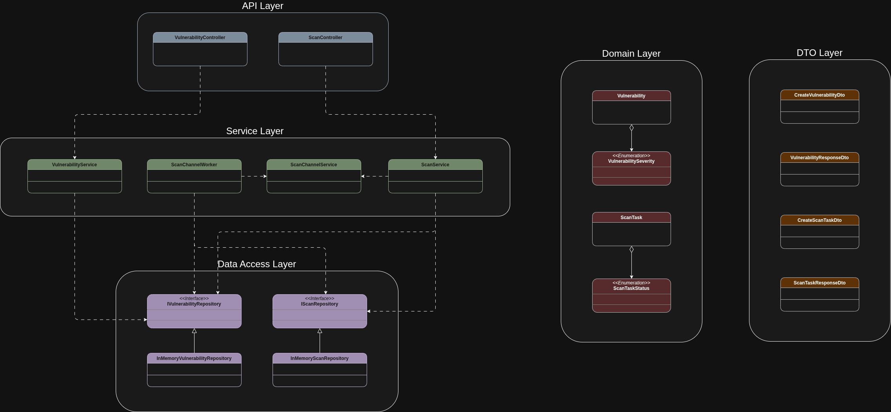

# Vulnerability Tracker API

REST API сервис на .NET 10 для управления уязвимостями ПО и эмуляции асинхронных задач сканирования репозиториев.

## 🔥 Solved tasks

- [x] Создан эндпоинт для добавления уязвимости
- [x] Создан эндпоинт для получения информации об уязвимости по ID
- [x] Создан эндпоинт для запуска фоновой задачи по сканированию кода репозитория
- [x] Создан эндпоинт для получения статуса и результата выполнения задачи сканирования
- [x] Добавлена возможность [настройки](#-configuration) ограничения параллельного сканирования
- [x] Создан эндпоинт для отмены сканирования

## 📌 API Endpoints Quick Reference

- **`POST /api/vulnerabilities`** - создание уязвимости
- **`GET /api/vulnerabilities/{id}`** - получение уязвимости по ID
- **`POST /api/scantasks`** - запуск сканирования репозитория
- **`GET /api/scantasks/{id}`** - получение статуса задачи сканирования
- **`POST /api/scantasks/{id}/cancel`** - отмена задачи сканирования

> 📖 **[Подробное описание](#-api-endpoints)**

## ⚙️ Technology stack

- **Platform:** .NET 10 (C#)
- **Web Framework:** ASP.NET Core Web API
- **Data Serialization:** `System.Text.Json`
- **Testing:** xUnit, Moq, FluentAssertions
- **Architecture:** In-memory Repository 

## 🚀 Quick start

> [!IMPORTANT] 
> Для запуска проекта убедитесь, что на вашем компьютере установлен .NET 10 SDK.

Запуск проекта локально через .NET CLI:

1. Склонируйте репозиторий и перейдите в рабочую директорию:

```bash
git clone https://github.com/arist0crab/KasperskyIntershipTask
```

2. Соберите и запустите приложение (из директории `VulnerabilityTrackerApi`):

```bash
dotnet run
```

3. Для запуска тестов выполните (из директории `VulnerabilityTrackerApi.Tests`):

```bash
dotnet test
```

4. Пример использования:

>[!IMPORTANT] 
> Убедитесь, что порт в запросах совпадает с портом, назначенным ASP.NET при запуске приложения.

```bash
arist0crab@arist0crab:~/VsCodeProjects/KasperskyIntershipTask$ curl -X POST "http://localhost:5118/api/vulnerabilities" \
     -H "Content-Type: application/json" \
     -d '{"name": "SQL Injection", "severity": "High"}'
```

Ответ:

```bash
{"id":"d5b56918-4b6a-4c3d-a576-7ba66f484b0c"}
```

## 🔧 Configuration

Параметры работы API можно настроить с помощью файла конфигурации `appsettings.json`:

```json
{
  "Logging": {
    "LogLevel": {
      "Default": "Information",
      "Microsoft.AspNetCore": "Warning"
    }
  },
  "AllowedHosts": "*",
  "ScanSettings": {
    "MaxConcurrentScans": 3,
    "MinScanTimeMs": 3000,
    "MaxScanTimeMs": 7000
  }
}
```

### Описание параметров

- `MaxConcurrentScans`: максимальное количество одновременно выполняющихся задач сканирования
- `MinScanTimeMs` - минимальная длительность симуляции процесса сканирования (в миллисекундах)
- `MaxScanTimeMs` - максимальная длительность симуляции процесса сканирования (в миллисекундах)

## 🌐 Interactive documentation (Swagger UI)

При запуске приложения в режиме разработки (`Development`) вы можете использовать встроенный Swagger UI для тестирования эндпоинтов из браузера:

- `http://localhost:<port>/swagger`

## 📁 About project

### Project structure

```text
KasperskyIntershipTask/
│
├── VulnerabilityTrackerApi/             # Основной REST API сервис
│   ├── Controllers/                     # Контроллеры эндпоинтов
│   ├── DTOs/                            # DTO-модели
│   ├── Exceptions /                     # Исключения
│   ├── Middlewares/                     # Логгирование
│   ├── Models/                          # Модели данных
│   ├── Repositories/                    # Интерфейсы и реализации хранилищ данных
│   ├── Services/                        # Бизнес-логика
│   ├── appsettings.json                 # Файл конфигурации
│   ├── Program.cs                       # Конфигурация пайплайна
│   └── VulnerabilityTrackerApi.csproj   # Файл проекта API
│
└── VulnerabilityTrackerApi.Tests/       # Модульные тесты
    ├── Controllers/                     # Юнит-тесты контроллеров
    ├── Services/                        # Юнит-тесты сервисов
    └── VulnerabilityTrackerApi.Tests.csproj # Файл проекта тестов
```

### 🧩 Project UML-diagram



## 📌 API Endpoints

### 📍 1. Управление уязвимостями (`/api/vulnerabilities`)

- **`POST /api/vulnerabilities`** - добавление новой записи об уязвимости.

  - 📥 **Request Body (`application/json`):**
    ```json
    {
      "name": "SQL Injection",
      "severity": "High"
    }
    ```

  - ✅ **Успешный ответ (`201 Created`):**

    Возвращает сгенерированный ID уязвимости.

    ```json
    {
      "id": "3fa85f64-5717-4562-b3fc-2c963f66afa6"
    }
    ```

  - ❌ **Ошибка (`500 Internal Server Error`):** 
    
    Возникает, если не удалось сохранить уязвимость.

    ```json
    {
      "message": "An error occurred while saving vulnerability"
    }
    ```

- **`GET /api/vulnerabilities/{id}`** - получение полной информации об уязвимости по её ID.

  - ✅ **Успешный ответ (`200 OK`):**

    Возвращает информацию о уязвимости, такую как имя, уровень критичности и время создания.

    ```json
    {
      "id": "3fa85f64-5717-4562-b3fc-2c963f66afa6",
      "name": "SQL Injection",
      "severity": "High",
      "created_at": "2026-03-30T12:00:00Z"
    }
    ```

  - ❌ **Ошибка (`404 Not Found`):** 

    Уязвимость с соответствующим ID не была найдена.

    ```json
    {
      "message": "No vulnerability with such id"
    }
    ```

### 📍 2. Фоновое сканирование (`/api/scantasks`)

- **`POST /api/scantasks`** - запуск фоновой задачи по сканированию кода.

  - 📥 **Request Body (`application/json`):**

    ```json
    {
      "repository_url": "https://github.com/example/repo"
    }
    ```

  - ✅ **Успешный ответ (`201 Created`):**

    Возвращает ID созданной задачи сканирования.

    ```json
    {
      "id": "7bc91e42-1234-5678-abcd-1234567890ab"
    }
    ```

  - ❌ **Ошибка (`500 Internal Server Error`):** 
  
    Возникает, если не удалось сохранить задачу.

    ```json
    {
      "message": "An error occurred while saving scan task"
    }
    ```

- **`POST /api/scantasks/{id}/cancel`** - отмена задачи сканирования (работает как для задач в очереди, так и для уже запущенных).

  - ✅ **Успешный ответ (`200 OK`):**

  Возвращает ID задачи сканирования на отмену, успех или неудачу отмены данной задачи в поле `success`, время попытки отмены.

  ```json
  {
    "id": "7bc91e42-1234-5678-abcd-1234567890ab",
    "success": true,
    "cancelled_at": "2026-03-30T12:02:00Z"
  }
  ```

  - ❌ **Ошибка (`404 Not Found`):** 

  Задача сканирования с соответствующим ID не была найдена.

  ```json
  {
    "message": "No scan task with such id"
  }
  ```

- **`GET /api/scantasks/{id}`** - получение статуса выполнения задачи сканирования и результат сканирования в случае успешного завершения заадчи.

  - ✅ **Успешный ответ (`200 OK`):**

    ```json
    {
      "scan_task_id": "7bc91e42-1234-5678-abcd-1234567890ab",
      "scan_task_status": "Completed",
      "scan_task_updated_at": "2026-03-30T12:05:00Z",
      "found_vulnerabilities": [
        {
          "id": "3fa85f64-5717-4562-b3fc-2c963f66afa6",
          "name": "SQL Injection",
          "severity": "High",
          "created_at": "2026-03-30T12:00:00Z"
        }
      ]
    }
    ```

  - ❌ **Ошибка (`404 Not Found`):** 
  
    Задача сканирования с соответствующим ID не была найдена.

    ```json
    {
      "message": "No scan task with such id"
    }
    ```